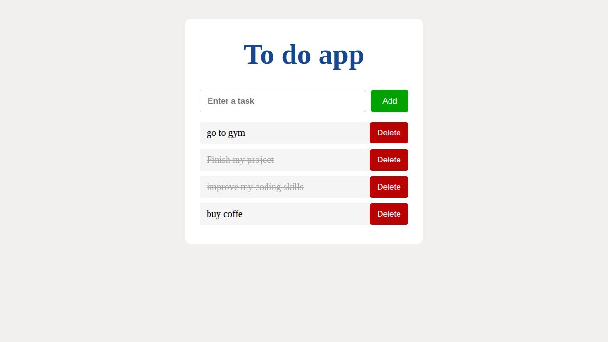

# Todo List App

A simple Todo List application built with Vanilla JavaScript that allows users to create, complete, and delete tasks. Tasks are automatically saved in the browser using Local Storage.

## Features

- Add new tasks
- Delete tasks
- Mark tasks as completed
- Persist tasks with Local Storage
- Restore tasks after page refresh
- Add tasks by pressing the Enter key
- Responsive layout

## Technologies

- HTML5
- CSS3
- JavaScript (ES6)
- Local Storage API

## Project Structure

```
todo-list/
├── index.html
├── style.css
├── app.js
└── screenshots/
    └── todo-app.png
```

## Getting Started

1. Clone the repository.
2. Open `index.html` in your browser.

No additional dependencies or installation are required.

## What I Learned

This project helped me practice:

- DOM manipulation
- Event handling
- Dynamic element creation
- Arrays and objects
- Local Storage
- JSON serialization
- User input validation
- Building interactive user interfaces with JavaScript

## Future Improvements

- Edit existing tasks
- Due dates
- Task categories
- Drag-and-drop sorting
- Filters (All / Active / Completed)
- Dark mode

## Screenshot

